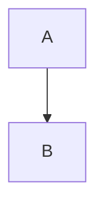

# remark-preview.nvim

A high-performance, highly customizable Markdown previewer for Neovim that utilizes the **remark-rehype** ecosystem to render GFM-compliant HTML, diagrams, and complex math directly in your browser.

## 🚀 Features

*   **Several previews at once**: every Markdown buffer gets its own URL and browser tab; saving a file updates only its own tab.
*   **Live updates without reloading**: the page is updated in place on save, so the scroll position and unchanged elements are kept.
*   **Images and links that work**: relative images (also `../assets/x.png` and images written as HTML), `#anchor` links and links to other Markdown files, which open in their own preview.
*   **Line-accurate scroll sync**: scroll the browser to the line under your cursor with one command, or let it follow the cursor.
*   **Obsidian vaults**: `[[wikilinks]]`, `[[Note#Heading]]`, `[[Note|alias]]` and `![[image.png|300]]` embeds, resolved by name like Obsidian does.
*   **Extended Math Support**:
    *   Standard LaTeX via `$...$` and `$$...$$`.
    *   **Ampersand Math**: Use `&...&` for inline and `&&...&&` for block **AsciiMath** (powered by KaTeX and rehype-asciimath).
*   **Diagrams**: Mermaid, PlantUML, Graphviz, and more, cached between renders. Mermaid and PlantUML are drawn on your machine, offline, when `merman-cli` and `plantuml` are installed; everything else (and those two when the tool is missing) is drawn by a Kroki server. Each diagram sits in a frame you can pan (drag), zoom (Ctrl+wheel, pinch or the − ⟲ + buttons) and resize (drag its bottom-right corner); the view and size survive saves. Transparent diagrams are automatically wrapped in high-contrast backgrounds for dark mode visibility.
*   **Advanced Task Lists**:
    *   Standard GFM `[ ]` and `[x]`.
    *   **Custom Markers**: Support for `[!]` (Important), `[?]` (Question), and `[>]` (Ongoing) with unique Nerd Font icons.
*   **Callouts & Alerts**: Support for GitHub-style alerts and Obsidian-style callouts (`[!NOTE]`, `[!WARNING]`, etc.).
*   **Styling & Themes**:
    *   Unified **Catppuccin** Mocha (Dark) and Latte (Light) themes, and plainer **GitHub** Dark and Light themes (`github-dark`, `github-light`) that look like GitHub renders Markdown.
    *   Automatic theme switching via configuration, and a menu in the page (top right) to switch themes from the browser; the choice is remembered in a cookie for every document, and is never written to your Neovim configuration.
    *   Optimized **Print Theme** for B&W paper exports.
*   **PDF export** with the print theme, including images and diagrams.
*   **Metadata Awareness**: Automatically ignores YAML/TOML frontmatter during rendering.
*   **Subscript & Superscript**: Native support for `~sub~` and `^super^` syntax.

## 🛠 Prerequisites

Before installing, ensure you have the following installed on your system:

*   **Neovim 0.10** or newer (Linux or macOS; Windows is not supported)
*   **Node.js 20** or newer, and **npm** (bundled with Node.js)
*   **Nerd Fonts**: Required for viewing custom task icons correctly.
*   **Chrome**, only for the PDF export: `npm install` lets puppeteer download one.
*   **Optional, to draw diagrams offline** (without them Kroki draws them, see "Security and privacy"):
    *   [`merman-cli`](https://github.com/Latias94/merman) for Mermaid: download a release binary and put it on your `PATH`, or `cargo install merman-cli`.
    *   [`plantuml`](https://plantuml.com) for PlantUML (needs Java).

## 📦 Installation

### Using [lazy.nvim](https://github.com/folke/lazy.nvim)

```lua
{
    "toki83w/remark-preview.nvim",
    ft = "markdown",
    -- Automatically install/update npm dependencies
    build = "npm install --prefix preview-engine",
    opts = {
        theme = "dark", -- "dark" (Mocha), "light" (Latte), "github-dark" or "github-light"
        pdf = {
            format = "A4",
            margin = "1cm"
        },
    },
    keys = {
        { "<leader>mp", "<cmd>RemarkPreviewToggle<cr>", desc = "Toggle Remark Preview" },
        { "<leader>ms", "<cmd>RemarkPreviewSyncPosition<cr>", desc = "Sync Preview Position" },
        { "<leader>me", "<cmd>RemarkPreviewExport open<cr>", desc = "Export & Open PDF" },
    },
}
```

## ⌨️ Commands

The preview commands act on the current buffer. The file must be saved to disk: the preview reads the file and updates when you save it.

*   `:RemarkPreviewToggle`: Starts or stops the preview of the current buffer. Several buffers can be previewed at the same time.
*   `:RemarkPreviewOpen`: Opens the preview in the browser (starts it if inactive).
*   `:RemarkPreviewSyncPosition`: Scrolls the browser to the line under the cursor.
*   `:RemarkPreviewExport [open]`: Exports the current file to PDF next to it, using the print theme. Optional `open` argument opens the PDF immediately.
*   `:RemarkPreviewRestart`: Restarts the preview server and re-opens every active preview.
*   `:RemarkPreviewStopAll`: Stops every preview and the server.
*   `:RemarkPreviewInstallDeps`: Triggers the installation of local NPM dependencies.
*   `:checkhealth remark-preview`: Verifies Neovim, Node.js, the npm packages and Chrome, and shows the configuration in use.

The preview server starts with the first preview and stops with the last one. It exits by itself if Neovim goes away.

## 📝 Syntax Examples

### Ampersand Math (AsciiMath)
Inline: `&x^2 + y^2 = r^2&`
Block:
```text
&&
E = mc^2
&&
```

### Custom Task Markers
```markdown
- [!] This is urgent
- [?] I have a question about this
- [>] This task is currently in progress
- [x] This is already done
```

### Sub/Superscript
Water is H~2~O. The area is 10m^2^.

### Diagrams
````markdown


```kroki type=plantuml alt="Sequence"
@startuml
A -> B: hello
@enduml
```
````

## 🔗 Images and links

Paths are resolved from the document, and a leading `/` means "from the project root". The **project root** is the nearest parent directory that contains `.obsidian` or `.git` (see `root_markers`), or the document's own directory when there is none. The home directory is never a root.

*   ``, `` and `` all work, as long as the file is inside the project root.
*   Only media is served: images (including SVG), audio, video and PDF. Other files, hidden files (`.env`, `.git/...`) and anything outside the project root are refused; such a reference is shown crossed out or dashed, with the reason in its tooltip.
*   `[other](other.md#section)` opens `other.md` in its own preview tab.
*   Links to other kinds of files (a `.zip`, a `.txt`) are shown as dead links.
*   A document you only reached through a link is refreshed when you save it from a preview of its own; otherwise reload the tab.

## 🗂 Obsidian vaults

Inside a vault (a project root containing `.obsidian`) these work like in Obsidian: files are found **by name**, wherever they are in the vault; with duplicate names the one closest to the current note wins, and `Folder/Note` picks one explicitly.

| Syntax | Result |
| --- | --- |
| `[[Note]]`, `[[Note\|alias]]` | link to the note's preview |
| `[[Note#Heading]]`, `[[#Heading]]` | link to a heading (of another or the same note) |
| `![[image.png]]`, `![[image.png\|300]]`, `![[image.png\|300x200]]` | the image, optionally sized |
| `[[file.pdf]]`, `![[Note]]` | a link to the file or note |
| `[[Missing]]` | shown dimmed, without a target |

Not supported yet: embedding a note's content (`![[Note]]` is a link), `#tags`, `%%comments%%` and block references (`[[Note#^id]]` links to the note). Inside a table, write the pipe as `\|`. Outside a vault `[[...]]` stays plain text unless you set `wikilinks = true`.

## ⚙️ Configuration

```lua
require("remark-preview").setup({
  theme = "dark",          -- "dark" (Mocha), "light" (Latte), "github-dark" or "github-light"
  port = 0,                -- 0 lets the OS pick a free port
  debug = false,           -- print debug messages
  sync_on_cursor = false,  -- scroll the preview along with the cursor
  root_markers = { ".obsidian", ".git" }, -- what marks the project root
  wikilinks = "auto",      -- Obsidian [[links]]: "auto" (inside a vault), true or false
  kroki = {
    server = "https://kroki.io", -- draws the diagrams no local tool draws, see "Security"
  },
  local_diagrams = true,   -- draw mermaid with `merman-cli` and plantuml with `plantuml` when they are on the PATH; false: always Kroki
  pdf = {
    format = "A4",
    margin = "1cm",
  },
})
```

`port_base` from earlier versions is no longer used: a warning is shown and it is ignored.

## 🔒 Security and privacy

*   The preview server listens on `127.0.0.1` only and rejects requests whose `Host` header is not its own (DNS rebinding). The URL that opens the preview carries a random token that the server exchanges for a cookie; requests without it are refused. The token is visible in the command line of the browser launcher for a moment, which matters on shared machines.
*   Files are served only from the project root, only media types, never hidden files, and symbolic links that lead out of the root are refused.
*   **Raw HTML in a document runs in the preview page**, as on GitHub's wiki or a local HTML file. Preview documents you do not trust at your own risk.
*   **Diagrams are drawn locally when they can be.** With `merman-cli` (mermaid) and `plantuml` (plantuml) on your `PATH`, those diagrams are drawn on your machine: nothing is sent anywhere and no internet is needed. The source of **every other diagram** (graphviz, ... and mermaid or plantuml when their tool is missing) **is sent to the Kroki server** (`https://kroki.io` by default); point `kroki.server` at a self-hosted instance for private documents, or see which tool draws what with `:checkhealth remark-preview`. When a local tool fails (a syntax error) the diagram shows the error, and its source is **not** sent to Kroki as a second attempt.
*   The local tools run on the document you preview, with a time limit (30 s) and a cap on parallel runs. PlantUML runs in its `SANDBOX` security profile, so a document cannot `!include` your files or read them; its standard library still works. Only `merman-cli` and `plantuml` are ever run, found on the `PATH`; set `local_diagrams = false` to turn them off.
*   The page loads its stylesheets for math, code and theming from CDNs, so the preview needs internet access for those. The PDF export needs it for the math styling too.
*   Chrome is started with `--no-sandbox` for the PDF export, which is needed in many containers.

## 🧪 Development

```sh
cd preview-engine && npm install   # once
npm test                            # Node tests (some use a real Chrome and skip without one)
cd .. && nvim --headless -u NONE -l tests/run.lua   # Lua tests, run from the repository root
stylua .                            # formatting
```

`node preview-engine/render-cli.js file.md` prints the HTML of a file, and `node preview-engine/export-cli.js file.md out.pdf` exports it without Neovim.

`examples/vault/features.md` is a reference document that uses every feature and says what to expect; `preview-engine/test/reference.test.js` keeps it honest. `examples/preview.sh` opens it (or any Markdown file) in Neovim with this checkout of the plugin and your own configuration left out, and starts the preview in the browser: `examples/preview.sh --help` lists the options. `examples/export.sh` turns it (or any Markdown file) into a PDF without Neovim and prints the path: `examples/export.sh --help` lists the options.

## 📄 License

MIT
