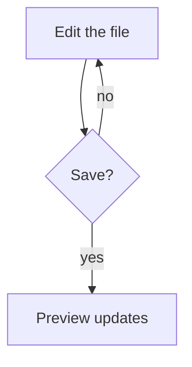
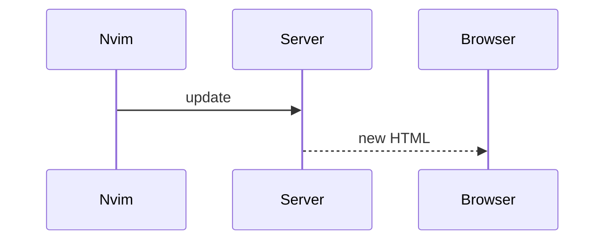
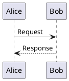
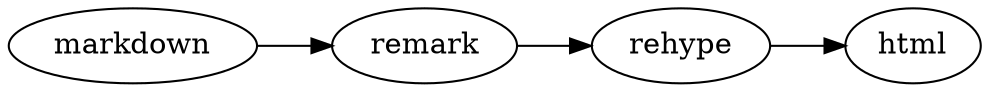
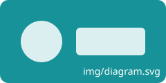

# Remark Preview reference

This document uses every feature of the plugin. Use it as a reference for the syntax and as a manual
check after a change: each section says what you should **Expect** to see. The frontmatter block above
must not be visible.

Open it with `:RemarkPreviewToggle`. The folder is an Obsidian vault (it contains `.obsidian`), so
wikilinks are enabled and files are found by name. The project root is this folder: images and links
may point anywhere inside it, and nowhere outside.

Contents: [Checklist](#checklist) · [Text](#text) · [Structure](#structure) · [Math](#math) ·
[Callouts](#callouts) · [Diagrams](#diagrams) · [Images](#images) · [Links](#links) ·
[Wikilinks](#wikilinks) · [Raw HTML](#raw-html) · [Scroll sync test](#scroll-sync-test) ·
[Not supported](#not-supported)

## Checklist

Tick these off while reading the preview (they are task lists, so they also show how tasks render).

- [ ] The browser opened one tab for this file, with the Catppuccin dark theme
- [ ] The ☰ button at the top left opens a sidebar listing the headings; it highlights the current one
- [ ] The dot at the top right is green (live connection)
- [ ] Edit the **live update marker** below, save, and the page changes without reloading or jumping
- [ ] Every section below shows what it says under **Expect**
- [ ] `:RemarkPreviewSyncPosition` scrolls the browser to the cursor line (see the last sections)
- [ ] `:RemarkPreviewExport open` produces a PDF with the print theme (black on white, no colours)
- [ ] `:checkhealth remark-preview` reports no errors

Live update marker: **edit this sentence and save**.

## Text

Plain text with *italic*, **bold**, ***bold italic*** and ~~strikethrough~~. Inline `code` and a
[link](https://example.org). A bare URL becomes a link too: https://example.org/path.

Highlighted text with ==double equals==. Subscript: H~2~O and CO~2~. Superscript: 10m^2^ and E=mc^2^.

A hard line break uses two trailing spaces  
or a backslash\
at the end of the line. A literal asterisk is written \*like this\*.

**Expect:** italic, bold and bold italic text; a struck-through word; a highlighted word with a light
background; subscript 2 in the formulas and a superscript 2 in the exponents; the URL clickable; the
two line breaks inside the paragraph; the escaped asterisks shown as characters.

## Structure

### Headings

#### Fourth level

##### Fifth level

###### Sixth level

**Expect:** five distinct heading sizes and colours. The sidebar lists levels one to four only.

### Lists

* Unordered item
* Another item
  * Nested item
    * Deeply nested item
* Last item

1. First step
2. Second step
   1. Sub-step
   2. Another sub-step
3. Third step

A list with paragraphs:

1. The first item

   continues in a second paragraph.

2. The second item.

**Expect:** bullets and numbers in the accent colour, nesting indented, paragraphs inside items aligned.

### Task lists

- [ ] An open task
- [x] A finished task
- [!] An important task (custom marker)
- [?] A question (custom marker)
- [>] A task in progress (custom marker)
- [x] A task with **bold** and `code`
  - [ ] A nested open task
  - [x] A nested finished task

**Expect:** a checkbox in front of each item, none clickable; the three custom markers each with its
own icon and colour (Nerd Font needed); no bullet points.

### Blockquotes

> A quotation spanning
> two lines.
>
> > A nested quotation.
>
> Back to the first level, with **formatting**.

**Expect:** a bar on the left, the nested quotation indented further.

### Tables

| Left aligned | Centered | Right aligned |
| :----------- | :------: | ------------: |
| `code`       | **bold** |           1.5 |
| a [link](#text) | *italic* |         22.75 |
| plain        | ~~gone~~ |           300 |

**Expect:** a bordered table, the three columns aligned left, centred and right, inline formatting in
the cells.

### Code blocks

```js
// JavaScript with syntax highlighting
export function greet(name = "world") {
  const message = `Hello, ${name}!`;
  return message.toUpperCase();
}
```

```python
# Python
def fibonacci(n: int) -> list[int]:
    numbers = [0, 1]
    while len(numbers) < n:
        numbers.append(numbers[-1] + numbers[-2])
    return numbers
```

```bash
# a shell script
for file in *.md; do
  echo "Checking $file" && grep -c "TODO" "$file"
done
```

```diff
- removed line
+ added line
  unchanged line
```

```
A block without a language is shown as plain text.
```

**Expect:** monospaced blocks with a border; keywords, strings and comments coloured in the first four
(the print theme and the PDF show no colours); the last block uncoloured.

### Horizontal rule

Text above.

---

Text below.

**Expect:** a line between the two paragraphs.

### Footnotes

A statement that needs a source.[^source] Another one.[^second]

[^source]: The first footnote, shown at the bottom of the page.
[^second]: The second footnote. It can have several words and `code`.

**Expect:** small numbers after the statements, linking to a list of notes at the end of the page.

## Math

Inline LaTeX: $a^2 + b^2 = c^2$ and $\alpha = e^{-i\pi}$.

Display LaTeX:

$$
\int_0^\infty e^{-x^2}\,dx = \frac{\sqrt{\pi}}{2}
$$

Inline AsciiMath between ampersands: &x^2 + y^2 = r^2& and &sum_(i=1)^n i = (n(n+1))/2&.

Block AsciiMath between double ampersands:

&&
E = mc^2
&&

&&
int_0^1 x dx = 1/2
&&

**Expect:** typeset formulas (not source code) in both kinds. The ampersand math is converted from
AsciiMath, so a pair of ampersands in ordinary text would turn into math too; that is why this document
never writes two of them in one paragraph outside of examples.

## Callouts

GitHub alerts:

> [!NOTE]
> Useful information that users should know.

> [!TIP]
> Helpful advice for doing things better.

> [!IMPORTANT]
> Key information users need to know.

> [!WARNING]
> Urgent info that needs immediate attention.

> [!CAUTION]
> Advises about risks or negative outcomes.

Obsidian callouts, with their own title and types:

> [!info] A custom title
> The text of an **info** callout with `code`.

> [!question] Is this supported?
> Yes.

> [!example]
> An example callout without a title.

> [!success]
> A success callout.

> [!failure]
> A failure callout.

> [!bug]
> A bug callout.

> [!quote]
> A quote callout.

Foldable callouts (a minus starts folded, a plus starts open):

> [!faq]- Click to unfold
> Hidden until you click the title.

> [!tip]+ Open at first
> Visible, and can be folded.

**Expect:** a box per callout with an icon, a title and an accent colour (related types share one: Tip and
Important look alike, as do Warning and Caution). The two foldable ones react to a click.

## Diagrams

Mermaid and PlantUML diagrams are drawn on your machine when `merman-cli` and `plantuml` are installed (see
`:checkhealth remark-preview`): no internet is needed and the source stays local. Every other diagram
(Graphviz, nomnoml, ...), and those two when their tool is missing or `local_diagrams = false`, is drawn
by a Kroki server (`https://kroki.io` unless you set `kroki.server`); that needs internet access and the
source of each diagram is sent to the server. If a diagram cannot be drawn (Kroki unreachable, or a syntax
error reported by a local tool) a placeholder appears and a yellow banner at the top of the page tells
you why; a diagram a local tool rejects is not sent to Kroki instead.

Every diagram sits in a frame you can pan and zoom: drag to move it, hold Ctrl and use the wheel (or
pinch on a trackpad) to zoom, or use the − ⟲ + buttons at the bottom right of the frame. Double-click or
⟲ fits it to the frame again. Drag the bottom-right corner of the frame to resize it (it can grow as tall as you like, and as wide as the page). The view and the size are kept when you save the file, and the PDF shows plain images.

Mermaid flowchart:



Mermaid sequence diagram:



PlantUML:



Graphviz:



Any other Kroki type through `kroki type=...`, here with an alternative text for accessibility:

```kroki type=nomnoml alt="A diagram drawn with nomnoml"
[Source] -> [Preview]
```

**Expect:** five drawings on a light background (so that transparent diagrams stay readable in the dark
theme). Save the file twice: the second render does not ask the server again (diagrams are cached).
Saving without internet shows the placeholder and the banner, and fixing the connection and saving
again clears it.

## Images

Relative to this document: 

An SVG: 

A name with a space (percent-encoded): 

Relative to the project root, with a leading slash: 

Written as HTML, with a size: 

A link around an image, to another note: [](Notes/Linked%20note.md)

Refused or missing references (each shows the reason in its tooltip, and none loads anything):

* Outside the project root: 
* A hidden file: 
* A file that does not exist: 

**Expect:** the first six show real pictures (the last one opens the linked note when clicked). The three
refused references appear as a dashed outline with their alternative text, and hovering shows why.

## Links

* To a heading of this document: [the math section](#math), or one with a custom text: [jump to callouts](#callouts)
* To another document, opening its own preview: [Linked note](Notes/Linked%20note.md)
* To a heading of another document: [Second heading](Notes/Linked%20note.md#second-heading)
* To an external site: [Example](https://example.org)
* To an email address: [write to someone](mailto:someone@example.org)
* A reference-style link: [the reference][ref]
* To a file type that is not served: [a text file](Notes/plain.txt)
* To a document that does not exist: [nothing](Notes/missing.md)

[ref]: https://example.org/reference "A title shown on hover"

**Expect:** the anchor links scroll within this page without leaving it. The link to the note opens a
second tab and keeps this one; the heading link opens it at the right place. The last two entries are
struck through and not clickable, with the reason in the tooltip.

## Wikilinks

This folder is an Obsidian vault, so these work as they do in Obsidian:

* A note found by its name alone: [[Linked note]]
* With another text: [[Linked note|an alias for the note]]
* To a heading: [[Linked note#Second heading]]
* To a heading of this same document: [[#Wikilinks]]
* A note in a deeper folder, found by name: [[Another note]]
* An image from another folder, found by name: ![[vault-pic.png]]
* The same image with a width: ![[vault-pic.png|120]]
* With width and height: ![[vault-pic.png|120x60]]
* With an alternative text: ![[vault-pic.png|the orange picture]]
* A note that does not exist: [[Missing note]]
* A note embedded with an exclamation mark (shown as a link, the content is not embedded): ![[Linked note]]

Inside a table the pipe of an alias has to be escaped:

| Written as | Shows |
| --- | --- |
| `[[Linked note\|alias]]` | [[Linked note\|alias]] |

**Expect:** every link works except the missing note, which is dimmed with a dashed underline and no
target. The images load. Wikilinks only work inside a vault; elsewhere they stay as plain text unless
`wikilinks = true`.

## Raw HTML

HTML is passed through, so these work: <kbd>Ctrl</kbd> + <kbd>S</kbd> to save, <mark>marked text</mark>,
a line<br>break, and <span style="color: #fe640b">coloured text</span>.

<details>
<summary>A collapsible section</summary>

Hidden content, with **markdown** inside.

</details>

<!-- An HTML comment: it must not appear anywhere. -->

**Expect:** keys drawn as buttons, a collapsible section that opens on click, the comment invisible.

## Scroll sync test

Put the cursor on a line below and run `:RemarkPreviewSyncPosition`: the same line should appear about
a third of the way down the browser window. With `sync_on_cursor = true` the browser follows the cursor.

Sync marker 01

Sync marker 02

Sync marker 03

Sync marker 04

Sync marker 05

Sync marker 06

Sync marker 07

Sync marker 08

Sync marker 09

Sync marker 10

Sync marker 11

Sync marker 12

Sync marker 13

Sync marker 14

Sync marker 15

Sync marker 16

Sync marker 17

Sync marker 18

Sync marker 19

Sync marker 20

Sync marker 21

Sync marker 22

Sync marker 23

Sync marker 24

Sync marker 25

**Expect:** whichever marker the cursor is on is the one near the top third of the window, also inside
long blocks such as the code samples above (the position is proportional within a block).

## Not supported

These are known limits, so a plain rendering here is not a bug:

* Embedding the content of a note: `![[Linked note]]` is shown as a link.
* Obsidian tags such as `#tag`, comments between percent signs, and links to a block by its id.
* Links to files that are not images, audio, video or PDF (they show as dead links).
* Anything outside the project root, hidden files, and absolute paths that leave the root.
* Windows.

The end of the reference document.
